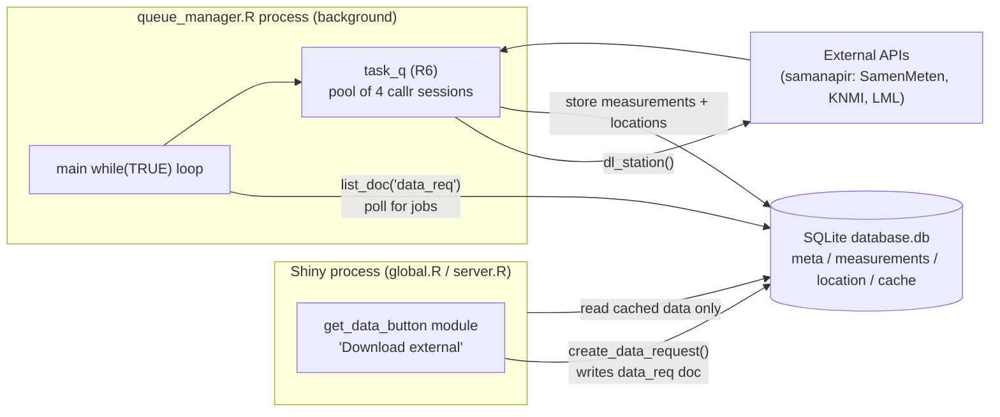
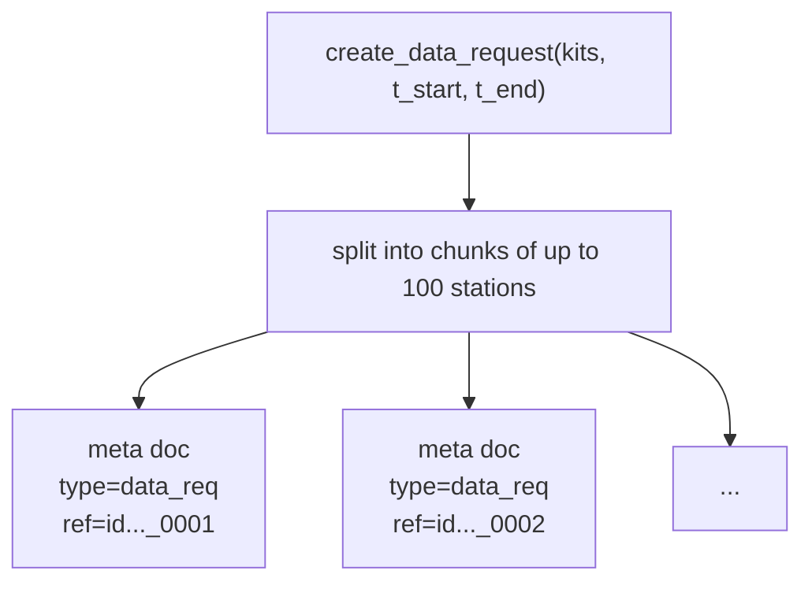
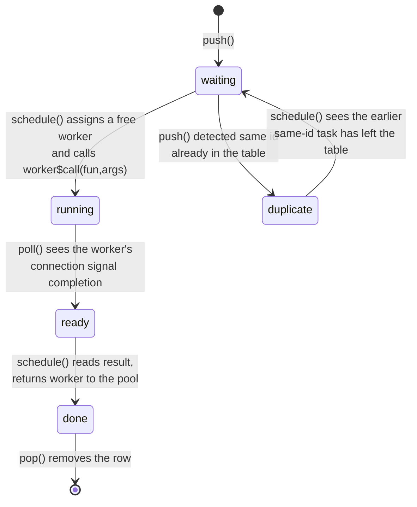
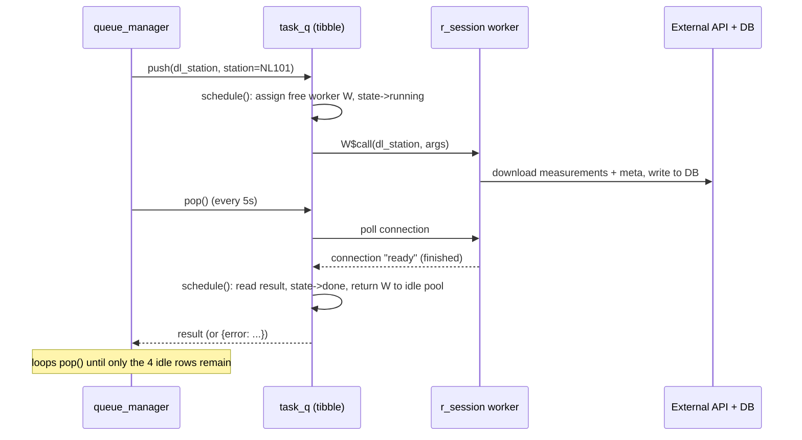
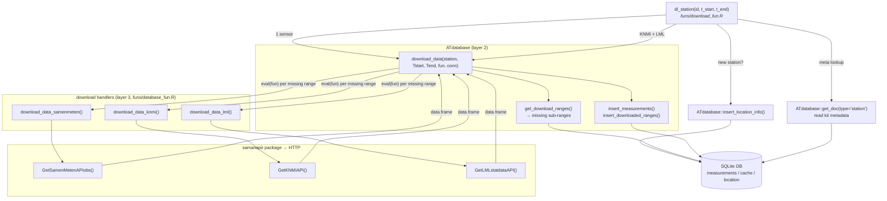
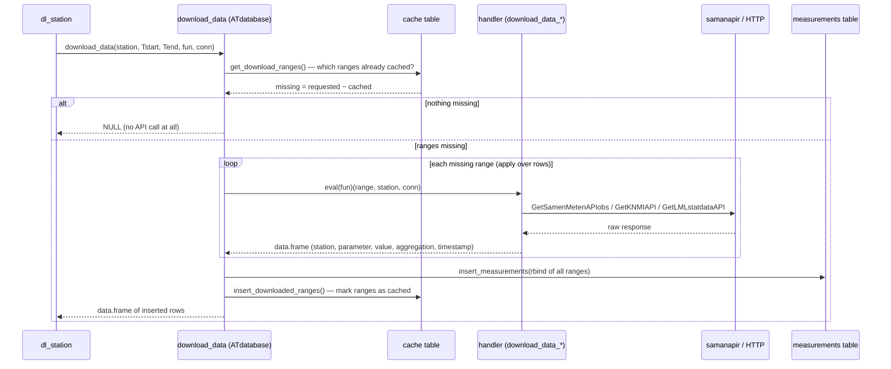
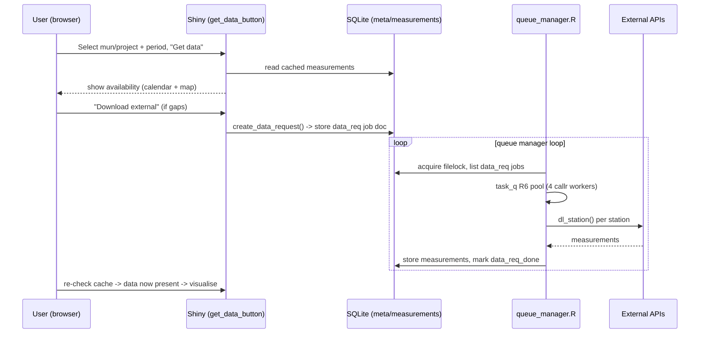

# Asynchronous Download & `task_q` Scheduler — Developer Guide

This document brings a new developer up to speed on the most complex part of the
Analyse Together application: the **asynchronous download subsystem**. It covers
the `task_q` scheduler, the `queue_manager.R` consumer process, and the
database-as-message-bus design that ties them together.

- Audience: developers new to the codebase.
- Scope: `funs/queue_fun.R`, `funs/download_fun.R`, `funs/scheduler_fun.R`,
  `scripts/queue_manager.R`, and the relevant parts of `global.R` and the
  `modules/get_data_button.R` module.

---

## 1. Why this exists (the core design idea)

Downloading sensor data from the Samen Meten / KNMI / LML APIs is **slow**
(minutes to hours for a whole municipality). Shiny is single-threaded per
session, so downloading inline would freeze the UI for every user.

The solution is a **producer/consumer system decoupled through the SQLite
database**:

- The **Shiny app** (producer) never downloads during browsing. It only *reads*
  cached data, and when data is missing it writes a **job document** ("data
  request") into the database.
- A **separate R process, `queue_manager.R`** (consumer), continuously polls the
  database for job documents, downloads the data in parallel using a pool of
  background R sessions (`task_q`), and writes the results back into the same
  database.

The database is both the **cache** and the **message bus**. There is no direct
socket/IPC between the two processes — they communicate only through rows in the
`meta` table.



Both processes are started from `global.R` at container boot:

```r
system2("Rscript", db_script, wait = TRUE)    # container_data_prep.R  (seed DB)
system2("Rscript", qm_script, wait = FALSE)   # queue_manager.R        (background downloader)
```

> **Note on dead code.** `global.R` also contains a *commented-out* in-app
> `que <- task_q$new()`, and `server.R` has a `suspended = TRUE` observer calling
> `que$poll()`. These are **disabled**. In production, `task_q` runs **only**
> inside the `queue_manager.R` process. Do not be misled by the app-side
> references.

### 1.1 Design rationale (why it is built this way)

- **Separate OS process + database as the queue.** The application is deployed as
  **multiple containers**, so a shared database (rather than in-process state) was
  preferred as the coordination point. Running the downloader as its own process
  also makes the Shiny application **more stable**, and moving queue management out
  of the (single-threaded) Shiny process **reduces CPU load** inside the app so the
  UI stays responsive.
- **File lock = single queue manager.** With several containers potentially
  running the same code against the same database, the `filelock` ensures that
  **only one container actually manages/drains the queue** at a time. The others
  back off until the lock is free.
- **Concurrency of 4.** Chosen for a balance of **limited container size** and
  **API politeness**. Experience showed 4 to be a good mix of download speed while
  keeping both the container and the upstream APIs performing well.
- **Duplicate-station deferral.** Added specifically to fix a **data-corruption
  bug** that occurred when the same station was downloaded concurrently (see
  §4.5a).

---

## 2. The unit of work: a "data request" job document

A job is created by `create_data_request()` (`funs/queue_fun.R`) and stored via
`ATdatabase::add_doc()` in the `meta` table with `type = "data_req"`.

- Input: a vector of `kits` (station ids) plus start/end times.
- Stations are chunked into sub-requests of at most `max_requests` (100) stations
  each.
- Each chunk is stored as a document with ref `id<random>_<seq>`, e.g.
  `id0123456789_0001`. The document body is a data frame of
  `station, time_start, time_end`.



Lifecycle of a job document in `meta`:

`data_req` (queued) → processed by queue_manager → removed and re-stored as
`data_req_done` (with timing stats).

---

## 3. `queue_manager.R` — the consumer loop

A single infinite `while(TRUE)` loop. Each iteration:


Key points:

- **One job document per iteration.** It takes `joblist[1]`, processes all its
  (up to 100) stations, then loops. Multiple job docs are handled sequentially
  across iterations.
- **A fresh `task_q` is created per job** and destroyed (`rm; gc()`) afterward —
  the 4 worker sessions are not kept alive between jobs.
- **`filelock`** (`data/lock`) guarantees only one downloader runs at a time even
  if several processes/containers point at the same DB. A process that cannot get
  the lock backs off 60–120 s. This is deliberate: the app is deployed as
  **multiple containers**, and only one of them should manage/drain the queue.
- **The `> 4` magic number** equals `concurrency` (4 idle worker rows always
  remain in the task table; see §4). So `nrow(tasks) > 4` means "real tasks still
  pending", and `njobs = nrow - 4`.
- **Watchdog.** Every 10th drain check (~every 50 s) it compares the pending
  count; if unchanged for more than 10 such checks it assumes a stall and breaks
  out (the job stays `data_req` and is retried later).
- **Scheduler.** When the queue has been empty for 12 polls (~6 min), and it is
  past the configured `02:00` and has not run today (`check_schedule`),
  `run_scheduled()` reads `prepped_data/schedule.csv` and enqueues fresh daily
  data requests for the listed municipalities/projects. See
  `funs/scheduler_fun.R`.

---

## 4. `task_q` — the parallel task scheduler (the subtle part)

`task_q` (`funs/queue_fun.R`) is an **R6 class** adapted from callr's official
"task queue" example (`?callr::r_session`). It manages a fixed pool of persistent
background R sessions and distributes tasks across them. The key to understanding
it is that **one tibble tracks both workers and tasks**.

### 4.1 The single state table

`private$tasks` is a tibble where **each row is either a worker slot or a task**:

| column        | meaning                                                             |
|---------------|--------------------------------------------------------------------|
| `id`          | task id (station id) or `.idle-N` for a worker slot                 |
| `seq`         | global push order (`.1`, `.2`, ...)                                 |
| `idle`        | **TRUE = permanent worker slot**, FALSE = real task                |
| `state`       | `waiting` -> `running` -> `ready` -> `done` (plus `duplicate`)      |
| `fun` / `args`| the function (`dl_station`) and its arguments                      |
| `worker`      | a `callr::r_session` object when one is attached, else `NULL`       |
| `result`      | the value read back from the worker                                 |

At construction, `start_workers(concurrency = 4)` inserts **4 permanent `idle`
rows**, each holding one `callr::r_session$new(wait = FALSE)` (a background R
process booting up). These 4 rows are never removed; they represent the worker
pool. Real tasks are always inserted **above** the idle rows
(`add_row(.before = first idle row)`), which matters for scheduling priority.

```
+- real tasks (idle = FALSE) ---------------------------+
| id=NL101  state=running  worker=W3   <- downloading   |
| id=NL202  state=waiting  worker=NULL <- queued        |
+- permanent worker slots (idle = TRUE) ----------------+
| id=.idle-1 state=ready   worker=W1   <- free          |
| id=.idle-2 state=ready   worker=W2   <- free          |
| id=.idle-3 state=waiting worker=NULL <- parked        |
| id=.idle-4 state=running worker=W4   (booting)        |
+-------------------------------------------------------+
```

### 4.2 The four public methods

- **`push(fun, args, id)`** — insert a task row above the idle rows, then call
  `schedule()`.
- **`poll(timeout)`** — ask the OS (`processx::poll`) which running worker
  connections have signalled completion, flip those rows `running -> ready`, then
  call `schedule()`. Returns ids of any `done` tasks.
- **`pop(timeout)`** — `poll()`, then remove the first `done` task row and return
  its `result` + `task_id`. Returns `NULL` if nothing is done.
- **`schedule()`** (private) — the engine; see §4.4.

### 4.3 State machine for a single task



### 4.4 How `schedule()` moves workers

`schedule()` runs on every `push`/`poll`. Conceptually:

1. **Harvest finished work.** Find rows in state `ready` (a worker signalled
   done). Read each worker's result into `result`, detach the worker
   (`worker <- NULL`), and set the row to `done` (real task) or `waiting` (idle
   slot that just finished booting).
2. **Dispatch to free workers.** Take the just-freed `r_session` objects and
   assign them to the **first** `length(ready)` rows that are in state `waiting`.
   Because real tasks sit *above* idle rows, waiting tasks are picked **before**
   idle slots — so a freed worker prefers to start a new download rather than
   park.
3. **Start execution.** For each newly-assigned row that is a real task
   (`idle == FALSE`), call `worker$call(fun, args)` — the download begins on that
   background session; the row goes `running`. Idle rows that received a worker
   just sit at `ready` (a booted, free worker).

The net effect: a conserved set of 4 `r_session` objects **circulates** between
task rows (while downloading) and idle slot rows (while free). The idle rows are
the "home" the workers return to when there is no pending task.



### 4.5 Two AT-specific customizations (not in the vanilla callr example)

These are the parts most likely to confuse someone comparing against the callr
docs:

**(a) Duplicate-station deferral.** The canonical `stop("Duplicate task id")` is
commented out. Instead, if you `push()` a station id that is already in the
table, the new row is marked `state = "duplicate"` and its id becomes
`"<seq> <station>"` (e.g. `.7 NL101`). Because `schedule()` only dispatches
`waiting` rows, a `duplicate` row never runs. On each `schedule()`, the
duplicates block strips the id back to the bare station and, **only if that
station is no longer present**, flips the row to `waiting` so it can run. This
**serializes downloads for the same station**, avoiding two workers hitting the
same station / DB rows concurrently. It was added specifically to fix a
**data-corruption bug** caused by concurrent downloads of the same station.

**(b) Done-task renaming.** When a real task reaches `done`, if its id does not
start with `.` it is renamed to `"<seq> <station>"`. This separates the *logical
station id* from the *row id*, so a not-yet-popped completed task does not look
like a duplicate of a fresh push of the same station, and `pop()` matches rows
unambiguously.

### 4.6 Bookkeeping helpers

`get_num_waiting()`, `get_num_running()`, `get_num_done()`, `is_idle()` (true when
`sum(!idle) == 0`, i.e. only the 4 worker slots remain) and `list_tasks()` expose
queue state. `scripts/test_functions.R::simple_task_list()` and
`modules/view_que.R` render a human-readable view (station / time range / state).

---

## 5. What one worker actually does: `dl_station()`

This is the part developers find hardest to follow, because one `dl_station()`
call fans out through **three layers of functions** before any HTTP request is
made, and the data flows back down through those same layers into the database.
This section walks the whole chain top to bottom.

### 5.1 The three layers

`dl_station()` itself contains almost no download logic. It is an **orchestrator**
that decides *which* stations to fetch and delegates the actual work to the
`ATdatabase` package, which in turn calls back into *download handler* functions
that live in the AT app. Keep these three layers separate in your mind:

| Layer | Where it lives | Responsibility |
|-------|----------------|----------------|
| **1. Orchestrator** | `funs/download_fun.R` → `dl_station()` | One sensor "kit". Opens the DB connection, reads the kit's metadata, and figures out the 3 related stations (the sensor itself, its KNMI weather station, its LML reference stations). Calls layer 2 once per station. |
| **2. Caching engine** | `ATdatabase::download_data()` (pkg `rivm-syso/ATdatabase`) | Source-agnostic. For a given station + time range it (a) asks the DB which sub-ranges are **missing**, (b) calls the handler to fetch *only* those, (c) writes the results and records the newly-cached ranges. Never talks to an API itself. |
| **3. Download handlers** | `funs/database_fun.R` → `download_data_samenmeten` / `download_data_knmi` / `download_data_lml` | Source-specific. Translate a time range into API calls (via the `samanapir` package), reshape the response into the canonical `measurements` column layout, and return a data frame. |

The crucial decoupling is between layer 2 and layer 3: `download_data()` is passed
the handler **by name** (`fun = "download_data_samenmeten"`) and invokes it with
`eval(fun)`. So the same caching/missing-range machinery is reused for all three
data sources — only the handler changes.

### 5.2 Call tree



### 5.3 Step-by-step: what happens on one call

`dl_station(id, time_start, time_end)` runs inside its own background `r_session`
(so a crash or hang never touches the Shiny app). It first opens its **own**
direct SQLite connection (`synchronous = "off"`, 120 s busy handler) — not the
Shiny connection pool — then:

1. **Sensor measurements.** Calls
   `download_data(id, …, fun = "download_data_samenmeten", conn)`. This is the
   kit's own particulate-matter sensor data from the Samen Meten API.
2. **Read kit metadata.** `get_doc(type = "station", ref = id, conn)` returns the
   kit's `station` document (previously written by the scheduler). It contains the
   codes needed to find the related reference stations: `knmicode` (weather) and
   `pm10closecode` / `pm25closecode` (the nearest official LML air-quality
   stations). If no metadata exists, it logs a warning, disconnects and returns —
   you only get KNMI/LML data for kits that have been catalogued.
3. **KNMI weather.** Derives the `KNMI_…` id from `knmicode` and calls
   `download_data(knmistation, …, fun = "download_data_knmi", conn)`. If that
   station's coordinates aren't in the `location` table yet
   (`station_exists()` is false), it fetches them with
   `download_locations_knmi()` and stores them via
   `ATdatabase::insert_location_info()`.
4. **LML reference stations.** For each unique `pm10closecode` / `pm25closecode`,
   calls `download_data(j, …, fun = "download_data_lml", conn)`, and likewise
   back-fills the station location with `download_locations_lml()` +
   `insert_location_info()` when missing.
5. **Disconnect.** Closes the connection and returns `NULL`. The return value is
   irrelevant — **all output is a side effect in the database**. That is what lets
   the result travel back to the Shiny app through the shared DB rather than
   through the `task_q` result channel.

### 5.4 Inside `download_data()` — the caching engine (layer 2)

Every one of those `download_data()` calls runs the same three-step algorithm.
This is the "smart cache" that makes re-requesting an already-downloaded period
cheap:



Three things to note:

- **Missing-range maths.** `get_download_ranges()` reads the already-cached
  `(start, end)` ranges for the station from the `cache` table and subtracts them
  from the requested window using interval arithmetic
  (`IntervalSurgeon::setdiffs`). On a station's first request the whole window is
  "missing"; on a repeat request the overlap is skipped. **This is why the system
  never re-downloads the same period twice** and why `cache` must be updated in
  the same transaction as the measurements.
- **The handler is the only source-specific code.** `apply(ranges, 1, eval(fun),
  …)` calls the named handler once per missing range row; results are
  `rbind`-ed together.
- **Cache is updated even when the API returns nothing.** If a handler returns
  `NULL` (e.g. a station with no data for that period), `download_data()` still
  calls `insert_downloaded_ranges()`. That records the range as "attempted" so a
  dead/empty station isn't retried forever.

### 5.5 Inside the handlers — reaching the APIs (layer 3)

Each handler has the signature `f(x, station, conn)` where `x` is a single
missing time range (a 2-element numeric vector of POSIX seconds). They all follow
the same shape: format the range as `YYYYMMDD`, call a `samanapir` API function,
then rename/reshape columns into the canonical measurement layout
(`station, parameter, value, aggregation, timestamp`, with `aggregation = 3600`
for hourly data):

| Handler | API function (`samanapir`) | Notes |
|---------|----------------------------|-------|
| `download_data_samenmeten` | `GetSamenMetenAPIobs()` | Reads the kit's `datastream` doc (`get_doc(type = "datastream")`) to get the list of datastream ids, then loops over them. Each API call is wrapped in `try()` so one failing stream doesn't abort the kit. Rows pivoted to long form. |
| `download_data_knmi` | `GetKNMIAPI()` | Weather variables (`wd`, `ws`, `temp`, `rh`) pivoted to long form; station prefixed `KNMI_`. |
| `download_data_lml` | `GetLMLstatdataAPI()` | Official air-quality reference data; returns an empty frame (not an error) when a station has no data. |

The location back-fill functions (`download_locations_knmi` via `GetKNMIAPI`'s
`info` block, `download_locations_lml` via `GetLMLstatinfoAPI`) are separate,
one-off lookups used only the first time a reference station is seen.

### 5.6 Where the data ends up

A single `dl_station()` call therefore writes to **three tables**, all through
the ATdatabase helpers, never with raw SQL from the AT app:

| Table | Written by | Contents after the call |
|-------|-----------|-------------------------|
| `measurements` | `insert_measurements()` (via a temp table + `INSERT … SELECT`) | The time-series rows for the sensor, its KNMI station and its LML stations. This is the cache the Shiny app reads back. |
| `cache` | `insert_downloaded_ranges()` | One row per `(station, start, end)` range now known to be fetched. Drives the missing-range maths above and the coverage view in `station_overview()`. |
| `location` | `insert_location_info()` | Coordinates for any KNMI/LML station seen for the first time. |

Because every layer shares the one `conn` opened at the top of `dl_station()`,
all of this lands in the **same** database file that the Shiny app reads — which
is exactly how a background download becomes visible to the user with no direct
process-to-process communication.

> **Terminology:** `dl_station` in `funs/download_fun.R` is deliberately named an
> "Example download function". It is the AT-specific glue; the reusable,
> source-agnostic machinery (`download_data`, `get_download_ranges`, `get_doc`,
> `insert_location_info`, the `measurements`/`cache`/`location`/`meta` schema)
> lives in the `rivm-syso/ATdatabase` package. When changing download behaviour,
> first decide which layer you are in.

---

## 6. Database tables involved

| table          | role                                                                                                                                                       |
|----------------|------------------------------------------------------------------------------------------------------------------------------------------------------------|
| `meta`         | document store (via `ATdatabase::add_doc/get_doc/list_doc`). Holds `data_req`, `data_req_done`, `schedule`, project/municipality info, `datastream`, `station` docs. **This is the job queue / message bus.** |
| `measurements` | downloaded time-series values (the cache the app reads)                                                                                                     |
| `location`     | station coordinates & metadata                                                                                                                              |
| `cache`        | per-station downloaded date ranges                                                                                                                          |

---

## 7. Configuration & operations

- **Environment variables:** `ANALYSETOGETHER_DATAFOLDER` (DB + lock + logs dir,
  default `./data`), `ANALYSETOGETHER_SCHEDULE` (schedule CSV, default
  `prepped_data/schedule.csv`), `ANALYSETOGETHER_LOGLEVEL` (see
  `funs/logging_fun.R`).
- **Concurrency** is the `task_q$new(concurrency = 4L)` argument;
  `queue_manager.R` uses the default 4 and the drain loop's `> 4` must match it.
  The value 4 is a deliberate balance of limited container size and API
  politeness — experience showed it to be a good mix of download speed and
  keeping both the container and the upstream APIs healthy.
- **Logs:** `data/queue.log` (manager), `data/download.log` (workers).
- **Helper scripts:** `scripts/create_data_request.R` (enqueue test jobs),
  `scripts/queue_test.R` (interactive task_q experimentation),
  `scripts/launch_queue_manager.R` (start manager + generate load),
  `scripts/monitor_db.R` / `scripts/analyse_download_duration.R` (observability).

---

## 8. End-to-end: the app side that produces a job

The producer path lives in `modules/get_data_button.R`:

1. The user selects a municipality/project + period and clicks **Get data**. The
   module reads the cache and shows availability (calendar + map).
2. If data is missing, the user clicks **Download external**
   (`do_download_external`), which:
   - downloads the sensor **metadata** synchronously
     (`download_sensor_meta`),
   - calls `create_data_request()` to write the `data_req` job document(s), and
   - computes the job's **queue position** (`waiting_number`), surfaced to the
     user by the `waiting_info` module.
3. From there the `queue_manager.R` process (§3) picks up the job and fills the
   cache. The user re-checks availability and, once present, visualises the data.


