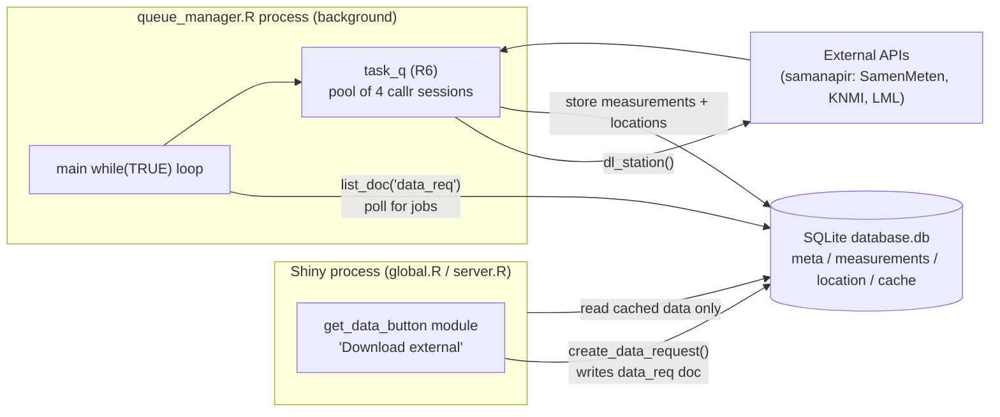
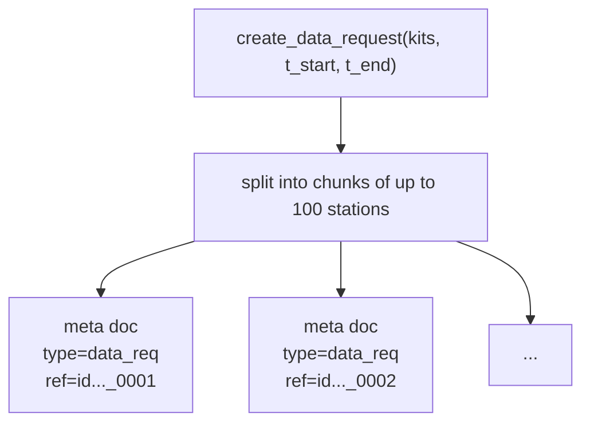
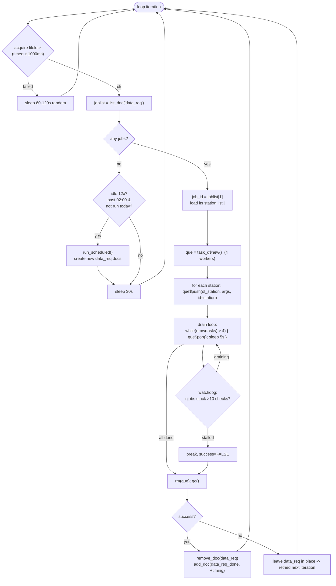
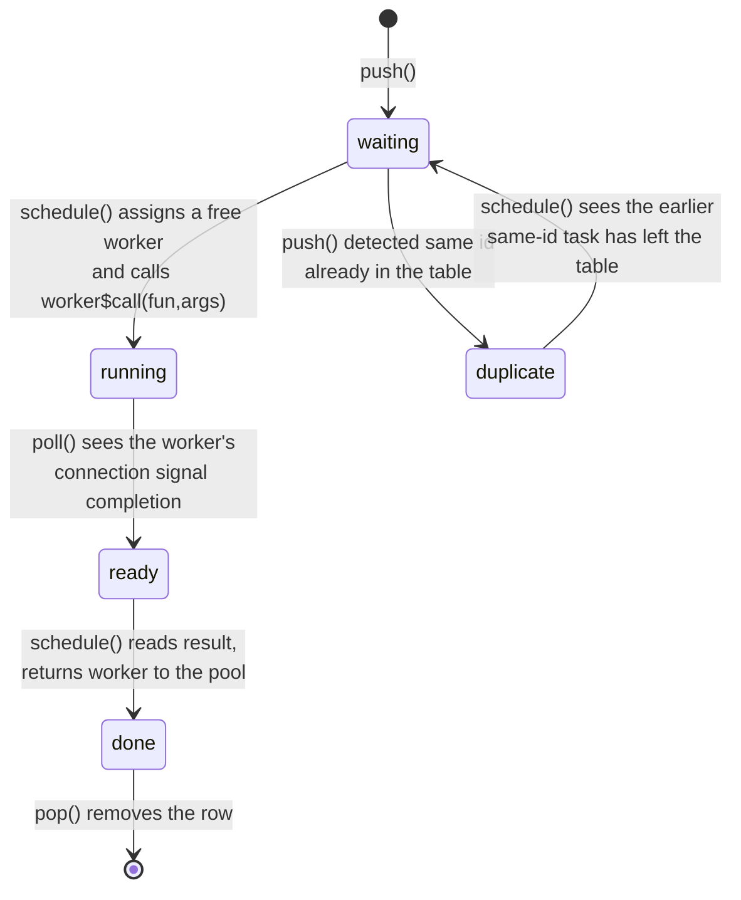
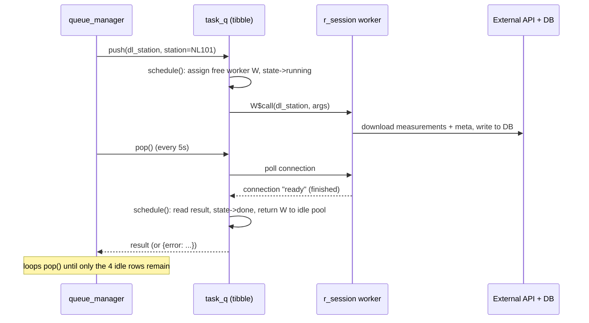
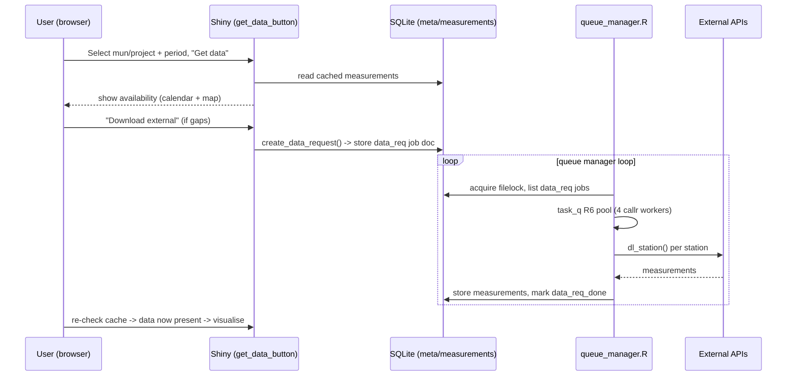

# Asynchronous Download & `task_q` Scheduler — Developer Guide

This document brings a new developer up to speed on the most complex part of the
Analyse Together application: the **asynchronous download subsystem**. It covers
the `task_q` scheduler, the `queue_manager.R` consumer process, and the
database-as-message-bus design that ties them together.

- Audience: developers new to the codebase.
- Scope: `funs/queue_fun.R`, `funs/download_fun.R`, `funs/scheduler_fun.R`,
  `scripts/queue_manager.R`, and the relevant parts of `global.R` and the
  `modules/get_data_button.R` module.

---

## 1. Why this exists (the core design idea)

Downloading sensor data from the Samen Meten / KNMI / LML APIs is **slow**
(minutes to hours for a whole municipality). Shiny is single-threaded per
session, so downloading inline would freeze the UI for every user.

The solution is a **producer/consumer system decoupled through the SQLite
database**:

- The **Shiny app** (producer) never downloads during browsing. It only *reads*
  cached data, and when data is missing it writes a **job document** ("data
  request") into the database.
- A **separate R process, `queue_manager.R`** (consumer), continuously polls the
  database for job documents, downloads the data in parallel using a pool of
  background R sessions (`task_q`), and writes the results back into the same
  database.

The database is both the **cache** and the **message bus**. There is no direct
socket/IPC between the two processes — they communicate only through rows in the
`meta` table.



Both processes are started from `global.R` at container boot:

```r
system2("Rscript", db_script, wait = TRUE)    # container_data_prep.R  (seed DB)
system2("Rscript", qm_script, wait = FALSE)   # queue_manager.R        (background downloader)
```

> **Note on dead code.** `global.R` also contains a *commented-out* in-app
> `que <- task_q$new()`, and `server.R` has a `suspended = TRUE` observer calling
> `que$poll()`. These are **disabled**. In production, `task_q` runs **only**
> inside the `queue_manager.R` process. Do not be misled by the app-side
> references.

### 1.1 Design rationale (why it is built this way)

- **Separate OS process + database as the queue.** The application is deployed as
  **multiple containers**, so a shared database (rather than in-process state) was
  preferred as the coordination point. Running the downloader as its own process
  also makes the Shiny application **more stable**, and moving queue management out
  of the (single-threaded) Shiny process **reduces CPU load** inside the app so the
  UI stays responsive.
- **File lock = single queue manager.** With several containers potentially
  running the same code against the same database, the `filelock` ensures that
  **only one container actually manages/drains the queue** at a time. The others
  back off until the lock is free.
- **Concurrency of 4.** Chosen for a balance of **limited container size** and
  **API politeness**. Experience showed 4 to be a good mix of download speed while
  keeping both the container and the upstream APIs performing well.
- **Duplicate-station deferral.** Added specifically to fix a **data-corruption
  bug** that occurred when the same station was downloaded concurrently (see
  §4.5a).

---

## 2. The unit of work: a "data request" job document

A job is created by `create_data_request()` (`funs/queue_fun.R`) and stored via
`ATdatabase::add_doc()` in the `meta` table with `type = "data_req"`.

- Input: a vector of `kits` (station ids) plus start/end times.
- Stations are chunked into sub-requests of at most `max_requests` (100) stations
  each.
- Each chunk is stored as a document with ref `id<random>_<seq>`, e.g.
  `id0123456789_0001`. The document body is a data frame of
  `station, time_start, time_end`.



Lifecycle of a job document in `meta`:

`data_req` (queued) → processed by queue_manager → removed and re-stored as
`data_req_done` (with timing stats).

---

## 3. `queue_manager.R` — the consumer loop

A single infinite `while(TRUE)` loop. Each iteration:



Key points:

- **One job document per iteration.** It takes `joblist[1]`, processes all its
  (up to 100) stations, then loops. Multiple job docs are handled sequentially
  across iterations.
- **A fresh `task_q` is created per job** and destroyed (`rm; gc()`) afterward —
  the 4 worker sessions are not kept alive between jobs.
- **`filelock`** (`data/lock`) guarantees only one downloader runs at a time even
  if several processes/containers point at the same DB. A process that cannot get
  the lock backs off 60–120 s. This is deliberate: the app is deployed as
  **multiple containers**, and only one of them should manage/drain the queue.
- **The `> 4` magic number** equals `concurrency` (4 idle worker rows always
  remain in the task table; see §4). So `nrow(tasks) > 4` means "real tasks still
  pending", and `njobs = nrow - 4`.
- **Watchdog.** Every 10th drain check (~every 50 s) it compares the pending
  count; if unchanged for more than 10 such checks it assumes a stall and breaks
  out (the job stays `data_req` and is retried later).
- **Scheduler.** When the queue has been empty for 12 polls (~6 min), and it is
  past the configured `02:00` and has not run today (`check_schedule`),
  `run_scheduled()` reads `prepped_data/schedule.csv` and enqueues fresh daily
  data requests for the listed municipalities/projects. See
  `funs/scheduler_fun.R`.

---

## 4. `task_q` — the parallel task scheduler (the subtle part)

`task_q` (`funs/queue_fun.R`) is an **R6 class** adapted from callr's official
"task queue" example (`?callr::r_session`). It manages a fixed pool of persistent
background R sessions and distributes tasks across them. The key to understanding
it is that **one tibble tracks both workers and tasks**.

### 4.1 The single state table

`private$tasks` is a tibble where **each row is either a worker slot or a task**:

| column        | meaning                                                             |
|---------------|--------------------------------------------------------------------|
| `id`          | task id (station id) or `.idle-N` for a worker slot                 |
| `seq`         | global push order (`.1`, `.2`, ...)                                 |
| `idle`        | **TRUE = permanent worker slot**, FALSE = real task                |
| `state`       | `waiting` -> `running` -> `ready` -> `done` (plus `duplicate`)      |
| `fun` / `args`| the function (`dl_station`) and its arguments                      |
| `worker`      | a `callr::r_session` object when one is attached, else `NULL`       |
| `result`      | the value read back from the worker                                 |

At construction, `start_workers(concurrency = 4)` inserts **4 permanent `idle`
rows**, each holding one `callr::r_session$new(wait = FALSE)` (a background R
process booting up). These 4 rows are never removed; they represent the worker
pool. Real tasks are always inserted **above** the idle rows
(`add_row(.before = first idle row)`), which matters for scheduling priority.

```
+- real tasks (idle = FALSE) ---------------------------+
| id=NL101  state=running  worker=W3   <- downloading   |
| id=NL202  state=waiting  worker=NULL <- queued        |
+- permanent worker slots (idle = TRUE) ----------------+
| id=.idle-1 state=ready   worker=W1   <- free          |
| id=.idle-2 state=ready   worker=W2   <- free          |
| id=.idle-3 state=waiting worker=NULL <- parked        |
| id=.idle-4 state=running worker=W4   (booting)        |
+-------------------------------------------------------+
```

### 4.2 The four public methods

- **`push(fun, args, id)`** — insert a task row above the idle rows, then call
  `schedule()`.
- **`poll(timeout)`** — ask the OS (`processx::poll`) which running worker
  connections have signalled completion, flip those rows `running -> ready`, then
  call `schedule()`. Returns ids of any `done` tasks.
- **`pop(timeout)`** — `poll()`, then remove the first `done` task row and return
  its `result` + `task_id`. Returns `NULL` if nothing is done.
- **`schedule()`** (private) — the engine; see §4.4.

### 4.3 State machine for a single task



### 4.4 How `schedule()` moves workers

`schedule()` runs on every `push`/`poll`. Conceptually:

1. **Harvest finished work.** Find rows in state `ready` (a worker signalled
   done). Read each worker's result into `result`, detach the worker
   (`worker <- NULL`), and set the row to `done` (real task) or `waiting` (idle
   slot that just finished booting).
2. **Dispatch to free workers.** Take the just-freed `r_session` objects and
   assign them to the **first** `length(ready)` rows that are in state `waiting`.
   Because real tasks sit *above* idle rows, waiting tasks are picked **before**
   idle slots — so a freed worker prefers to start a new download rather than
   park.
3. **Start execution.** For each newly-assigned row that is a real task
   (`idle == FALSE`), call `worker$call(fun, args)` — the download begins on that
   background session; the row goes `running`. Idle rows that received a worker
   just sit at `ready` (a booted, free worker).

The net effect: a conserved set of 4 `r_session` objects **circulates** between
task rows (while downloading) and idle slot rows (while free). The idle rows are
the "home" the workers return to when there is no pending task.



### 4.5 Two AT-specific customizations (not in the vanilla callr example)

These are the parts most likely to confuse someone comparing against the callr
docs:

**(a) Duplicate-station deferral.** The canonical `stop("Duplicate task id")` is
commented out. Instead, if you `push()` a station id that is already in the
table, the new row is marked `state = "duplicate"` and its id becomes
`"<seq> <station>"` (e.g. `.7 NL101`). Because `schedule()` only dispatches
`waiting` rows, a `duplicate` row never runs. On each `schedule()`, the
duplicates block strips the id back to the bare station and, **only if that
station is no longer present**, flips the row to `waiting` so it can run. This
**serializes downloads for the same station**, avoiding two workers hitting the
same station / DB rows concurrently. It was added specifically to fix a
**data-corruption bug** caused by concurrent downloads of the same station.

**(b) Done-task renaming.** When a real task reaches `done`, if its id does not
start with `.` it is renamed to `"<seq> <station>"`. This separates the *logical
station id* from the *row id*, so a not-yet-popped completed task does not look
like a duplicate of a fresh push of the same station, and `pop()` matches rows
unambiguously.

### 4.6 Bookkeeping helpers

`get_num_waiting()`, `get_num_running()`, `get_num_done()`, `is_idle()` (true when
`sum(!idle) == 0`, i.e. only the 4 worker slots remain) and `list_tasks()` expose
queue state. `scripts/test_functions.R::simple_task_list()` and
`modules/view_que.R` render a human-readable view (station / time range / state).

---

## 5. What one worker actually does: `dl_station()`

Each task runs `dl_station(id, time_start, time_end)` (`funs/download_fun.R`)
inside its own background R session. It opens its **own** direct SQLite connection
(not the pool) with a 120 s busy handler, then for one sensor:

1. Downloads the sensor's measurements (`download_data_samenmeten` via
   `ATdatabase::download_data`).
2. Reads the sensor's metadata doc to find its associated **KNMI** weather station
   and **LML** reference stations, downloads those measurements too, and inserts
   any missing station **locations**.
3. Writes everything to `measurements` / `location`, logging to
   `data/download.log`.

The `cache` table records which `(station, start, end)` ranges have been fetched
(used by `station_overview()` to visualise coverage).

---

## 6. Database tables involved

| table          | role                                                                                                                                                       |
|----------------|------------------------------------------------------------------------------------------------------------------------------------------------------------|
| `meta`         | document store (via `ATdatabase::add_doc/get_doc/list_doc`). Holds `data_req`, `data_req_done`, `schedule`, project/municipality info, `datastream`, `station` docs. **This is the job queue / message bus.** |
| `measurements` | downloaded time-series values (the cache the app reads)                                                                                                     |
| `location`     | station coordinates & metadata                                                                                                                              |
| `cache`        | per-station downloaded date ranges                                                                                                                          |

---

## 7. Configuration & operations

- **Environment variables:** `ANALYSETOGETHER_DATAFOLDER` (DB + lock + logs dir,
  default `./data`), `ANALYSETOGETHER_SCHEDULE` (schedule CSV, default
  `prepped_data/schedule.csv`), `ANALYSETOGETHER_LOGLEVEL` (see
  `funs/logging_fun.R`).
- **Concurrency** is the `task_q$new(concurrency = 4L)` argument;
  `queue_manager.R` uses the default 4 and the drain loop's `> 4` must match it.
  The value 4 is a deliberate balance of limited container size and API
  politeness — experience showed it to be a good mix of download speed and
  keeping both the container and the upstream APIs healthy.
- **Logs:** `data/queue.log` (manager), `data/download.log` (workers).
- **Helper scripts:** `scripts/create_data_request.R` (enqueue test jobs),
  `scripts/queue_test.R` (interactive task_q experimentation),
  `scripts/launch_queue_manager.R` (start manager + generate load),
  `scripts/monitor_db.R` / `scripts/analyse_download_duration.R` (observability).

---

## 8. End-to-end: the app side that produces a job

The producer path lives in `modules/get_data_button.R`:

1. The user selects a municipality/project + period and clicks **Get data**. The
   module reads the cache and shows availability (calendar + map).
2. If data is missing, the user clicks **Download external**
   (`do_download_external`), which:
   - downloads the sensor **metadata** synchronously
     (`download_sensor_meta`),
   - calls `create_data_request()` to write the `data_req` job document(s), and
   - computes the job's **queue position** (`waiting_number`), surfaced to the
     user by the `waiting_info` module.
3. From there the `queue_manager.R` process (§3) picks up the job and fills the
   cache. The user re-checks availability and, once present, visualises the data.


